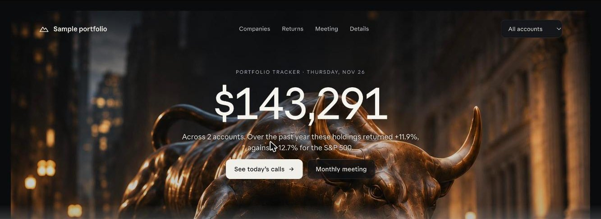
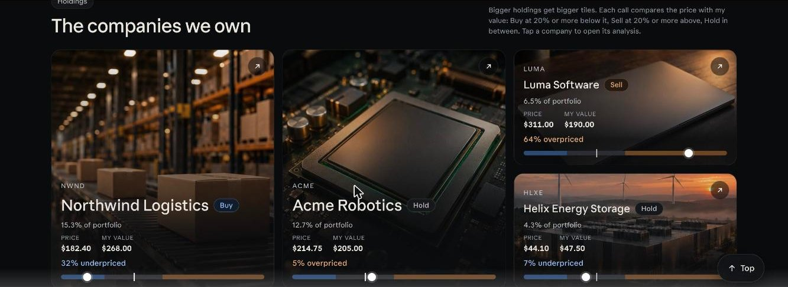
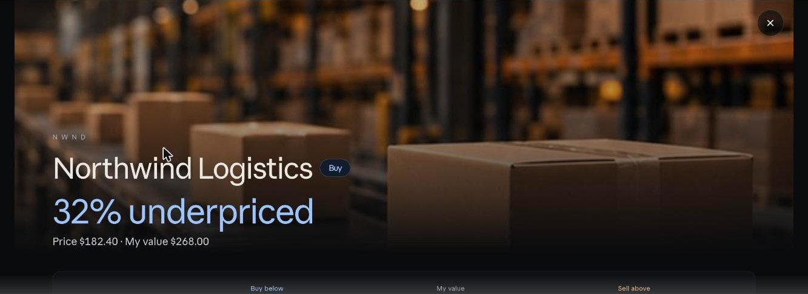
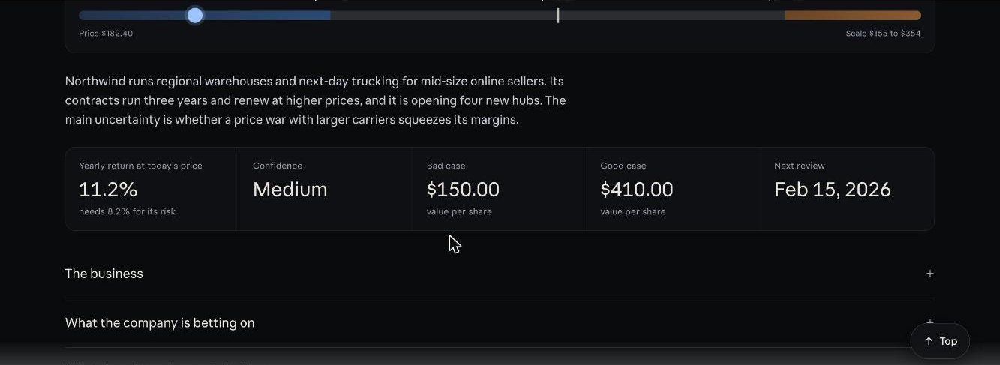

# Portfolio tracker kit

A personal stock-portfolio tracker that Claude Code builds for you from a screenshot of your brokerage account.

You clone this repo, open Claude Code in it, and share screenshots of your positions. Claude reads them, asks you a few plain questions about what each account is for, and builds a private dashboard page in your claude.ai account. After that, Claude can value your stocks one at a time and write you a monthly "meeting letter", like a short review with an advisor.

**This is not financial advice.** It is a tool for your own analysis. Claude never places trades, never logs in to your brokerage, and can be wrong. Check anything important with a licensed professional.

## What it looks like

Every company and number below is made up. Your page shows your own holdings.

## What the tracker shows

- Your total value, today's change, and your gain over what you paid, for all accounts or one at a time.
- One button per account, with what that money is for (in your words).
- A photo tile for each company you own, sized by how much of your portfolio it is. Each tile shows the price, "my value" (Claude's estimate of what one share is worth), and a Buy, Hold, or Sell call: Buy when the price is 20% or more below my value, Sell when it is 20% or more above, Hold in between.
- Tap a company to open its full analysis.
- Your returns against the S&P 500 over 1 month to 10 years, with dividends counted.
- Concentration: your largest holdings as bars.
- The latest monthly meeting letter, with its numbered moves.
- Full tables: every position, returns by account, accounts with what a 35% stock fall would cost each one, and private-company equity if you have any.

Prices refresh from Yahoo Finance's free data, weekly or whenever you ask. No paid data, no API keys.

## How the analysis works

`analyze-stock` values one company at a time. A separate Claude agent builds the value **without seeing the stock price**, so the price cannot pull the estimate toward itself. Only after the value is locked does Claude compare it with the market price. Scripts do all the arithmetic. Each analysis is saved as a dated report you can read in full.

`portfolio-review` runs monthly. It checks each holding, then looks at the whole portfolio: concentration, whether each account's risk fits its purpose and date, cash, and tax cost. It writes at most five suggested moves, in order, and "do nothing" is a common answer.

## How to use it

You need Claude Code and a claude.ai account that can create Artifacts. Python 3.9 or later is the only other requirement (no packages to install).

1. Fork or clone this repo. Make your fork **private** if you plan to keep your data in it (see below).
2. Open Claude Code in the folder.
3. Take screenshots of each brokerage account's positions page, with the cost basis column showing. Crop out account numbers.
4. Paste the screenshots into Claude Code and say something like "Set up my portfolio tracker."

Claude follows the first-run steps in `CLAUDE.md`. It takes a few minutes, plus a few questions for you. At the end you get a link to your private tracker page.

Things to say later:

- "Refresh prices."
- "I bought 10 shares of ACME in my IRA at $150." (or share new screenshots)
- "Analyze ACME."
- "Run the monthly portfolio review."

## Privacy

- Your holdings, trades, financial picture, analyses, and letters stay in files on your computer. The `.gitignore` keeps all of them out of git, so pushing your fork does not publish them.
- The tracker page is a private artifact in your claude.ai account. It stays private unless you share it.
- Price lookups send only ticker symbols to Yahoo Finance. Nothing else about you leaves your computer, apart from your normal use of Claude.
- The `examples/` folder holds fictional samples only.

### Keeping your data in git

By default your data is never committed. If your fork is **private** and you want version history of your holdings and reports, remove the lines you want tracked from `.gitignore` (for example `data/holdings.json`, `data/trades.jsonl`, `analyses/`, `reviews/`). Do this only in a private repo. Never do it in a public fork.

## What's in the repo

| Path | What it is |
|---|---|
| `CLAUDE.md` | Setup and upkeep steps for Claude |
| `.claude/skills/` | The three skills: `portfolio-sync`, `analyze-stock`, `portfolio-review` |
| `page/index.html` | The tracker page |
| `docs/` | Preview screenshots with made-up data |
| `examples/demo/` | Made-up dashboard data for the live sample |
| `page/photos/` | AI-generated photos for the page (a bull for the hero and a skyline for fund pages; CLAUDE.md explains how to make company photos) |
| `scripts/` | Price refresh, page-data build, and data checks |
| `examples/` | Fictional sample files that show each personal file's shape |

## Changing the defaults

The analysis settings (the 20% Buy and Sell rule, the hurdle rate, and others) are in `.claude/skills/analyze-stock/references/settings.default.json`, with a note on each. To change one, ask Claude; it writes only the changed setting to `context/analysis-settings.json`.
